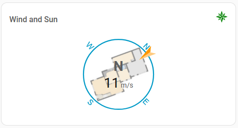

# Compass card

A custom [Home Assistant](https://home-assistant.io/) dashboard card that displays an indicator in a circle.

[![GitHub Release][releases-shield]][releases-link] [![GitHub Release Date][release-date-shield]][releases-link] [![GitHub Releases][latest-download-shield]][traffic-link] [![GitHub Releases][total-download-shield]][traffic-link]

[![HACS Badge][hacs-shield]][hacs-link] [![HomeAssistant][home-assistant-shield]][home-assistant-link] [![License][license-shield]][license-link]

![Project Maintenance][maintenance-shield] [![GitHub Activity][activity-shield]][activity-link] [![Open bugs][bugs-shield]][bugs-link] [![Open enhancements][enhancements-shield]][enhancement-link]

[![Community Forum][forum-shield]][forum-link] [![Buy Me A Coffee][coffee-shield]][coffee-link]

## Example



## Installation

### [HACS](https://hacs.xyz/) (Home Assistant Community Store)

1. Go to HACS page on your Home Assistant instance
1. Select `Frontend`
1. Press add icon and search for `compass`
1. Select Compass Card repo and install
1. Force refresh the Home Assistant page (<kbd>Ctrl</kbd> + <kbd>R</kbd>)
1. Add compass-card to your page

### Manual

1. Download the 'compass-card.js' from the latest [release](https://github.com/tomvanswam/compass-card/releases) (with right click, save link as)
1. Place the downloaded file on your Home Assistant machine in the `config/www` folder (when there is no `www` folder in the folder where your `configuration.yaml` file is, create it and place the file there)
1. In Home Assistant go to `Configuration->Lovelace Dashboards->Resources` (When there is no `resources` tag on the `Lovelace Dashboard` page, enable advanced mode in your account settings, and retry this step)
1. Add a new resource
   1. Url = `/local/compass-card.js`
   1. Resource type = `module`
1. Force refresh the Home Assistant page (<kbd>Ctrl</kbd> + <kbd>F5</kbd>)
1. Add compass-card to your page

## Using the card

- Add the card with the visual editor
- Or add the card manually and [configure it with YAML](https://github.com/tomvanswam/compass-card/wiki/1.-YAML-configuration)

### Visual editor

The visual editor covers every option of the card. It is split into groups:

- **Header**: title and icon, each with its own color, visibility and dynamic style.
- **Indicators** and **Values**: the list of sensors. Drag to reorder, and click a sensor to open its details: entity, attribute, units, decimals, the style of each part (indicator, value, units, abbreviation), a dynamic style per part and a tap action.
- **Compass**: the N/E/S/W letters, circle (line width, background image and opacity), ticks, offset and scale.
- **Card**: the language of the direction abbreviations, the behaviour for an unknown direction, the tap action of the card and debug logging.

Options left at their default value are not written to the YAML.

### Dynamic style

Every part can change its color, visibility and (for indicators and the circle) image, size, radius, opacity or background image depending on the value of an entity. Each band applies from its `from_value` up to the next band.

When a dynamic style has no `sensor` of its own, its entity is chosen in this order:

1. The `sensor` (and `attribute`) of the dynamic style itself.
2. For a part of an indicator or value sensor: that sensor itself.
3. Otherwise (header and compass): the first value sensor, or the first indicator when there are no value sensors.

### Unknown direction

`unknown_direction` sets what an indicator does when its value is no direction (for example `unavailable`):

- `north` (default): point north
- `last`: keep the last known direction
- `hide`: hide the indicator and its direction text

### Tap action

`tap_action` can be set on the card and on each indicator and value sensor, with the standard Home Assistant actions (`more-info`, `navigate`, `url`, `perform-action`, `toggle`, `assist`, `none`). A sensor's `more-info` without `entity` opens its own entity, the card's opens the first indicator's entity.

```yaml
type: custom:compass-card
unknown_direction: last
tap_action:
  action: navigate
  navigation_path: /dashboard-weather
indicator_sensors:
  - sensor: sensor.wind_direction
    tap_action:
      action: more-info
```

### Breaking changes after version 3.5.0

1. **A dynamic style of an indicator or value sensor follows that sensor.** A `dynamic_style` without `sensor` on `indicator`, `state_value`, `state_units` or `state_abbreviation` of an indicator, or on `state_value` or `state_units` of a value sensor, used to follow the first value sensor (or the first indicator). It now follows its own sensor. To keep the old behaviour, set `sensor` (and `attribute`) in the dynamic style.
2. **`background_image` must be a URL.** On the circle and in dynamic styles it now has to be a full `http(s)://` URL or a path starting with `/` (like `/local/compass.png`), or empty, the same as an indicator `image`.
3. **Relative image paths are rejected.** An image like `images/local/arrow.png` is no longer accepted; use `/local/arrow.png`.
4. **0 is a value.** `0` for opacity, size, radius, line width, decimals and offsets is now used as `0` instead of falling back to the default.

## Wish/Todo list

- See [open enhancements](https://github.com/tomvanswam/compass-card/issues?q=state%3Aopen%20label%3Aenhancement)

## Contact

You can find me on the [Home Assistant Community Site](https://community.home-assistant.io/t/compass-card-points-you-in-the-right-direction/217909)<br />
And occasionally on the [HACS](https://discord.gg/apgchf8) and [Home Assistant](https://www.home-assistant.io/join-chat) Discord

## Thanks to

- [@rsnodgrass](https://github.com/rsnodgrass) for the idea to make this
- [@iantrich](https://www.github.com/iantrich) for the [boiler-plate card](https://github.com/custom-cards/boilerplate-card), which got me started
- [@vingerha](https://github.com/vingerha) for creating the dynamic background image, mdi icon support and much more
- [All the translators](https://github.com/tomvanswam/compass-card/wiki/1.-YAML-configuration#language)

## Support

Help me out for a couple of :beers:, a :coffee: or legos!<br />
Or clone, and create and a PR to help make the card even better.

[](https://www.buymeacoffee.com/tomvanswam)

[releases-shield]: https://img.shields.io/github/release/tomvanswam/compass-card.svg?style=flat-square
[releases-link]: https://github.com/tomvanswam/compass-card/releases/latest
[release-date-shield]: https://img.shields.io/github/release-date/tomvanswam/compass-card?style=flat-square
[latest-download-shield]: https://img.shields.io/github/downloads/tomvanswam/compass-card/latest/total?style=flat-square&label=downloads%20latest%20release
[total-download-shield]: https://img.shields.io/github/downloads/tomvanswam/compass-card/total?style=flat-square&label=total%20views
[traffic-link]: https://github.com/tomvanswam/compass-card/graphs/traffic
[hacs-shield]: https://img.shields.io/badge/HACS-Default-orange.svg?style=flat-square
[hacs-link]: https://github.com/hacs/integration
[home-assistant-shield]: https://img.shields.io/badge/Home%20Assistant-visual%20editor/yaml-green?style=flat-square
[home-assistant-link]: https://www.home-assistant.io/
[license-shield]: https://img.shields.io/github/license/custom-cards/boilerplate-card.svg?style=flat-square
[license-link]: LICENSE.md
[activity-shield]: https://img.shields.io/github/commit-activity/y/tomvanswam/compass-card.svg?style=flat-square
[activity-link]: https://github.com/tomvanswam/compass-card/commits/master
[bugs-shield]: https://img.shields.io/github/issues/tomvanswam/compass-card/bug?color=red&style=flat-square&label=bugs
[bugs-link]: https://github.com/tomvanswam/compass-card/labels/bug
[enhancements-shield]: https://img.shields.io/github/issues/tomvanswam/compass-card/enhancement?color=blue&style=flat-square&label=enhancements
[enhancement-link]: https://github.com/tomvanswam/compass-card/labels/enhancement
[maintenance-shield]: https://img.shields.io/maintenance/yes/2026.svg?style=flat-square
[forum-shield]: https://img.shields.io/badge/community-forum-brightgreen.svg?style=flat-square
[forum-link]: https://community.home-assistant.io/t/compass-card-points-you-in-the-right-direction/217909
[coffee-shield]: https://img.shields.io/badge/donate-buymeacoffe-sienna?style=flat-square
[coffee-link]: https://www.buymeacoffee.com/tomvanswam
